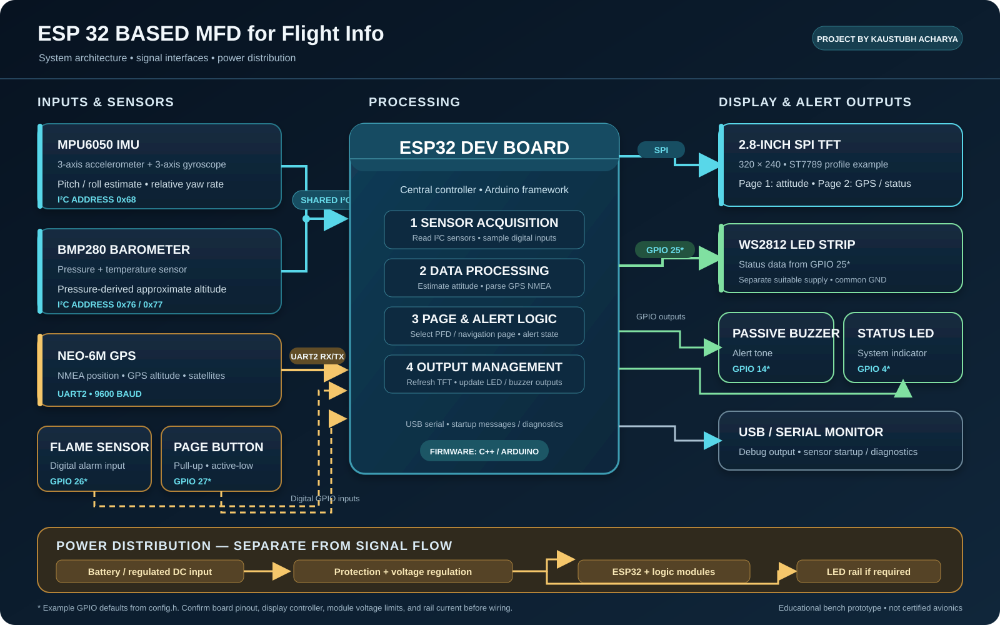

# ESP 32 BASED MFD for Flight Info



<p align="center"><strong>System architecture and signal-flow diagram</strong></p>

**An independent embedded-systems project by Kaustubh Acharya.**

This project develops a compact, two-page Multi-Function Display (MFD) using an ESP32. It collects data from an inertial measurement unit, a barometric pressure sensor, a GPS receiver, and a digital flame-sensor input, then presents selected information on a 2.8-inch SPI TFT.

The repository is written as both a working firmware project and a learning resource. The guides explain what each component does, why each communication protocol is used, how the firmware is organised, and how to bring up the hardware in safe stages.

> **Project ownership:** Author, developer, and maintainer — **Kaustubh Acharya**. This is a solo project. The repository's current project documentation and firmware identify Kaustubh Acharya as its sole author and owner.

> **Safety notice:** This is an educational bench prototype for learning embedded systems and displaying supplementary sensor data. It is not a certified aircraft instrument, flight controller, navigation system, or safety-critical device. Do not use it as the sole basis for operating an aircraft or UAV.

## 1. What the project does

An aircraft MFD combines information from several electronic systems into one readable display. This project demonstrates the same general idea on a small ESP32 platform:

- **Page 1 — Attitude and pressure:** displays an accelerometer-derived pitch/roll estimate, a relative gyro-integrated yaw value, pressure, and approximate barometric altitude.
- **Page 2 — Navigation and status:** displays GPS latitude/longitude, GPS altitude, satellite count, barometric altitude, temperature, and the flame-sensor input state.
- **Physical page button:** switches between the two pages.
- **Status outputs:** a WS2812 LED strip, a status LED, and a passive buzzer provide simple indication.
- **Serial diagnostics:** the USB serial monitor reports which I²C sensors were detected at startup.

## 2. System block diagram

The diagram above is a vector SVG. It shows the intended signal interfaces and separates signal wiring from power distribution:

- MPU6050 and BMP280 share one I²C bus.
- NEO-6M communicates with ESP32 UART2.
- The flame sensor and page button are digital GPIO inputs.
- The TFT receives display data over SPI.
- WS2812, buzzer, and status LED are controller outputs.
- The LED strip may require a separate current-capable supply; its ground must be common with the controller ground.

The GPIO numbers in the diagram are example defaults from `config.h`, not a substitute for checking the exact board and wiring.

## 3. Hardware and interfaces

| Module | What it contributes | Interface in this project |
|---|---|---|
| ESP32 DevKit (30-pin example) | Main controller; runs the firmware | GPIO, I²C, UART, SPI |
| 2.8-inch SPI TFT, 320 × 240 | Two-page MFD user interface | SPI via TFT_eSPI |
| MPU6050 | Acceleration and angular-rate measurements | I²C, default address 0x68 |
| BMP280 | Atmospheric pressure and temperature | I²C, commonly 0x76 or 0x77 |
| NEO-6M GPS | Position, GPS altitude, satellite information | UART2, default 9600 baud |
| BY-029 / KY-026 flame module | Digital flame indication | Digital GPIO |
| WS2812 strip | Visual status indication | One-wire data GPIO |
| Passive buzzer | Audible warning tone | GPIO output, driver if required |
| Page pushbutton | Selects the active display page | GPIO input with pull-up |

**Display-controller check:** the supplied TFT_eSPI profile is an ST7789 example. Some 2.8-inch modules use ILI9341 or another controller. Identify the actual display before selecting the profile.

## 4. How the firmware works

The firmware follows a repeatable embedded-systems loop:

1. **Initialise hardware:** configure GPIO, serial ports, TFT, I²C, and optional LEDs.
2. **Detect sensors:** attempt to initialise the MPU6050 and BMP280 and report their status.
3. **Acquire data:** read IMU and barometer measurements; continuously feed GPS bytes to the NMEA parser.
4. **Interpret measurements:** estimate pitch/roll from accelerometer axes, integrate gyro Z rate as relative yaw, and calculate approximate pressure altitude.
5. **Handle user input:** debounce the page button and toggle the active page on a stable press.
6. **Render and alert:** refresh the selected page and update the status outputs.

The loop uses `millis()`-based intervals for sensor and display updates instead of putting a long delay between every screen refresh. This makes the button and GPS processing more responsive.

## 5. Learn the project in the right order

A useful learning sequence is:

1. Read [the project learning guide](docs/PROJECT_LEARNING_GUIDE.md) to understand the system.
2. Study [the firmware walkthrough](docs/FIRMWARE_WALKTHROUGH.md) before editing the sketch.
3. Check [the hardware wiring reference](docs/HARDWARE_WIRING.md).
4. Follow [the installation guide](docs/INSTALLATION.md) to configure Arduino IDE and TFT_eSPI.
5. Bring up one subsystem at a time using [the bench test plan](docs/TEST_PLAN.md).
6. Read [known limitations](docs/KNOWN_LIMITATIONS.md) before interpreting sensor values.

## 6. Repository layout

```text
esp32_mfd/
├── README.md
├── LICENSE
├── CITATION.cff
├── CHANGELOG.md
├── CONTRIBUTING.md
├── .gitattributes
├── .gitignore
├── docs/
│   ├── diagrams/
│   │   └── ESP32_MFD_System_Block_Diagram.svg
│   ├── PROJECT_LEARNING_GUIDE.md
│   ├── FIRMWARE_WALKTHROUGH.md
│   ├── HARDWARE_WIRING.md
│   ├── INSTALLATION.md
│   ├── TEST_PLAN.md
│   └── KNOWN_LIMITATIONS.md
├── extras/
│   └── Setup_ESP32_ST7789.h
└── firmware/
    └── ESP32_MFD_Flight_Info/
        ├── ESP32_MFD_Flight_Info.ino
        └── config.h
```

## 7. Quick start

1. Install Arduino IDE 2.x and ESP32 board support.
2. Install the libraries listed in [INSTALLATION.md](docs/INSTALLATION.md).
3. Configure TFT_eSPI for the exact display controller fitted to your module.
4. Open `firmware/ESP32_MFD_Flight_Info/ESP32_MFD_Flight_Info.ino`.
5. Compare each pin in `config.h` with the actual wiring; change the constants if required.
6. Select the correct ESP32 board and COM port, then use **Verify** before **Upload**.
7. Keep propellers and motors disconnected during all bench tests.

## 8. Default GPIO map

| Function | ESP32 GPIO |
|---|---:|
| I²C SDA | 21 |
| I²C SCL | 22 |
| GPS RX2 (GPS TX → ESP32 RX) | 16 |
| GPS TX2 (ESP32 TX → GPS RX) | 17 |
| TFT SCLK / MOSI / CS / DC / RST | 18 / 23 / 5 / 2 / 15 |
| Page button | 27 |
| Flame sensor digital input | 26 |
| WS2812 data | 25 |
| Passive buzzer | 14 |
| Status LED | 4 |

These are firmware defaults only. Check pin restrictions, board variant, display wiring, sensor breakout voltage limits, and any pin conflicts before connecting hardware.

## 9. Power and electrical design

Treat the power system as a separate design task from the signal diagram. Use a charger/protection arrangement appropriate to the selected cell, then use regulated rails suitable for the ESP32 board, sensor breakouts, display, and LED strip. A charger module is not automatically a voltage regulator or a load-sharing power supply.

- Do not connect a bare 3.7 V Li-ion cell directly to the ESP32 3V3 pin.
- Do not assume every ESP32 board's VIN pin accepts the same voltage range.
- Size any external LED supply for the strip's maximum current and connect grounds correctly.
- Never power a high-current LED strip, motor, or relay directly from an ESP32 GPIO.
- Verify all rails with a multimeter before connecting the modules.

## 10. Important measurement limitations

- The MPU6050 has no magnetometer. The displayed yaw is a gyro integration and will drift; it is not a compass heading.
- The current pitch/roll calculation uses accelerometer readings only. Dynamic acceleration and vibration can look like tilt.
- BMP280 altitude is an estimate based on pressure and a reference sea-level pressure. Weather changes the result.
- GPS values are only useful after a valid fix. Indoor reception may be unavailable.
- Flame-sensor comparator polarity and threshold depend on the breakout module.
- This repository has not been validated for vibration, EMI, thermal extremes, flight dynamics, or certification.

## Maintainer

**Kaustubh Acharya**  
Independent project author and maintainer.
